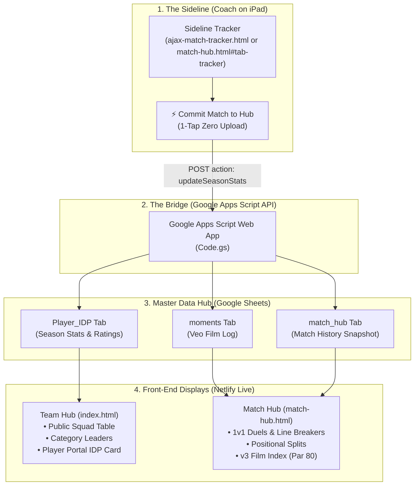

# Ajax Aspire U15 · Sideline Tracker & Data Integrity Guide

A complete reference guide for Coach Shawn Craig on how the **Ajax Aspire U15** platform connects from the sideline on your iPad directly into the **Team Hub**, **Match Hub**, and **Google Sheets Master Data Hub**.

---

## 1. System Architecture Overview

The system operates across three tightly integrated layers:

---

## 2. Where Everything Lives (The Data Integrity Map)

If you ever need to inspect, verify, or make raw manual edits to your data, here is exactly where each item lives in your **Google Sheets Master Data Hub**:

| Google Sheet Tab | Purpose | Key Columns / Data Tracked | Used By |
| :--- | :--- | :--- | :--- |
| **`Player_IDP`** | **Canonical Roster & Season Totals** | `Player Name`, `PIN`, `Coach Notes`, `Games Played`, `Minutes Played`, `Average Minutes`, `Goals`, `Assists`, `Shots On Target`, `Shots Off Target`, `Fouls`, `Clean Sheets`, `Win %`, `Turnovers Def 3rd`, `Key Passes`, `Duels`, `IDP_Submitted` (Col M) | • **Team Hub** Public Squad Table • Category Leaders • Player IDP Login Portal • Player Self-Ratings |
| **`moments`** | **Film Moments & Bookmarks** | `Timestamp`, `Match Name`, `Time (MM:SS)`, `Half`, `Jersey #`, `Field Zone` (D3/M3/A3), `Event Category`, `Short Form`, `Quality / Outcome` (Glow/Grow/Neutral), `Coach Comment`, `Film Review` (TRUE/FALSE) | • **Match Hub** Film Room • **v3 Film Index** (Par 80) • Individual Film Clips in Player Portal |
| **`match_hub`** | **Cloud Key-Value Store** | `key` (`notes`, `takeaways`, `datasets`, `match_history`), `value` (JSON String), `updated_at` | • Tactical Whiteboard notes • Coach Game Takeaways • Match Audit Log |
| **`coaching_videos`** | **Video Library** | `Category`, `Title`, `Vimeo/YouTube URL`, `Key Takeaways`, `Assigned Position` | • Film Room Video Library • Tactical Walkthroughs |
| **`challenges`** | **Competency & Homework** | `Title`, `Description`, `Target Reps`, `Points`, `Leaderboard Log` | • Compete Leaderboard • Weekly Skills Challenges |
| **`Reflections_Log`** | **Player Reflections History** | `Timestamp`, `Player Name`, `Reflection Text`, `Coach Reply` | • Feedback Loop • Unread Reply Banners |

---

## 3. How to Make Raw Edits Safely

If you ever need to fix a typo, correct minutes, or adjust a score manually:

### ⚠️ Non-Negotiable Rules for Manual Edits
1. **The Roster Spells the Names:** Always keep spelling identical to column A of `Player_IDP`. The system matches by name (`normName`), ignoring capitalization and punctuation (e.g. `Sophia Culver`, `Camila Deleon`).
2. **Column Names Are Exact:** Do not rename the headers in row 1 of `Player_IDP` or `moments`. Front-end scripts and Google Apps Script find data by exact header text.
3. **Player PINs Belong in Column B of `Player_IDP`:** Never share or expose player PINs publicly.
4. **Updating Apps Script:** If you ever edit code inside the Google Sheets Script Editor (`Code.gs`), always deploy as a **New Version of the Existing Deployment** (Deploy > Manage Deployments > Edit > Version: New Version > Deploy). Never create a brand-new deployment, as that changes the URL.

---

## 4. Match Day Sideline Workflow (Step-by-Step on iPad)

### Before Kickoff
1. Open [ajax-match-tracker.html](file:///Users/shawncraig/Desktop/Anti%20Gravity%20SC/ajax-match-tracker.html) (or tap the **Match Tracker** tab inside `match-hub.html`).
2. Tap **`⚙️ Match Setup`**: enter opponent name (e.g. *Rocklin*, *La Morinda*).
3. Review Starting XI on the visual pitch. If you want to change who starts:
   - Tap a pitch position (e.g. `CF`)
   - Tap a player on the available substitutes tray below to sub them into that spot.

### During the Game
- **Clock Controls:** Tap **`▶`** at kickoff. The clock automatically accrues on-pitch minutes to all 11 active players every 60 seconds.
- **1-Tap Player Actions (Auto-Clearing):**
  - Tap any player on the pitch (e.g. `#23 Sophia Culver`).
  - Tap their action: `⚽ Goal`, `🅰️ Assist`, `🔑 Key Pass`, `💪 Duel Won`, `❌ Duel Lost`, `🎯 Shot On`, `🥅 Shot Off`, `🧤 Save (GK)`, or `⚠️ Turnover` *(picks D3, M3, or A3)*.
  - **The app immediately logs the event and automatically unselects the player**, so your next tap will never accidentally swap positions!
- **Opponent Actions:** Tap `+ Opp Goal`, `+ Opp Shot`, `+ Opp Sub` (tracks their sub windows/counts), or `+ Corner`.
- **Sideline Bookmarks (Amber Button):**
  - Tap **`📌 Flag Moment for Film`** at any second.
  - Instantly drops a bookmark (e.g. `📌 Flagged for Film Review (18:45) · #8 Scarlett`) so you can find the play on Veo later without typing notes.
- **Substitutions:**
  - Tap the player coming off on the pitch.
  - Tap the substitute coming on from the bench tray.
  - Sub is logged with timestamp, and minutes immediately route to the new player.
- **Position Swaps:**
  - Tap Player A on the pitch.
  - Tap **`🔄 Swap Field Position`**.
  - Tap Player B. Their positions swap instantly without subbing out.

### At the Final Whistle
1. Tap **`⏭`** to record Full Time.
2. Tap the large green **`⚡ COMMIT MATCH TO HUB`** button in the top bar.
3. Confirm the match score and minutes.
4. **Everything updates automatically:**
   - **Match Hub** updates standings, minutes splits, turnovers by third, duels, and film moments.
   - **Google Sheets (`Player_IDP`)** receives updated cumulative season stats via background API.
   - **Team Hub (`index.html`)** immediately reflects the new stats in the public squad table and player IDP portals.

---

## 5. Post-Match Veo Film Review Workflow

When you sit down with your laptop or iPad to watch the Veo match replay:
1. Open **Match Hub** (`match-hub.html#film`).
2. Switch to the **Post-Match Film Study** tab.
3. Review the **Sideline Bookmarks** list from the game—each one has the exact game minute when it occurred.
4. Jump to that minute on Veo.
5. Tap **`🎙️ Hold to Speak Moment`** (or type a quick note) and tag the zone (D3/M3/A3) and outcome (`Glow` or `Grow`).
6. Tap **`Save to Film Room`**—the moment is immediately saved into the `moments` Google Sheet tab and added to the player's personal film review feed in her IDP portal.
