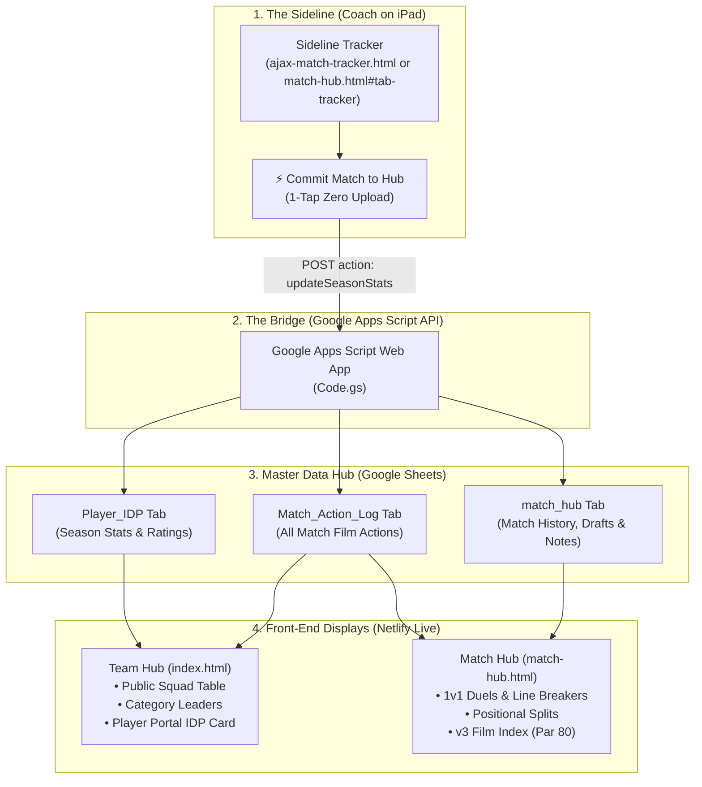

# Ajax Aspire U15 · Sideline Tracker & Data Integrity Guide

A complete reference guide for Coach Shawn Craig on how the **Ajax Aspire U15** platform connects from the sideline on your iPad directly into the **Team Hub**, **Match Hub**, and **Google Sheets Master Data Hub**.

---

## 1. System Architecture Overview

The system operates across three tightly integrated layers:

---

## 2. Where Everything Lives (The Data Integrity Map)

If you ever need to inspect, verify, or make raw manual edits to your data, here is exactly where each item lives in your **Google Sheets Master Data Hub**:

| Google Sheet Tab | Purpose | Key Columns / Data Tracked | Used By |
| :--- | :--- | :--- | :--- |
| **`Player_IDP`** | **Canonical Roster & Season Totals** | `Player Name`, `PIN`, `Coach Notes`, `Games Played`, `Minutes Played`, `Average Minutes`, `Goals`, `Assists`, `Shots On Target`, `Shots Off Target`, `Fouls`, `Clean Sheets`, `Win %`, `Turnovers Def 3rd`, `Key Passes`, `Duels`, `IDP_Submitted` (Col M) | • **Team Hub** Public Squad Table • Category Leaders • Player IDP Login Portal • Player Self-Ratings & 10 Coach Skill Ratings |
| **`Match_Action_Log`** | **Canonical Match Film & Action Log** | `Event_ID`, `Match_Date`, `Match_Name`, `Opponent`, `Half`, `Match_Clock`, `Zone`, `Outcome` (`Glow`/`Grow`/`Goal Conceded`/`Goal Scored`), `Category`, `Tag`, `Player_Name`, `Jersey_Num`, `Coach_Notes`, `Film_Review` (`TRUE`/`FALSE`), `Status`, `Last_Updated` | • **Match Hub** Film Room & Inline Clip Editor • **v3 Film Index** (Par 80) • Authenticated Player Portal Film Moments (`Coach_Notes` shown only when `Film_Review = TRUE`) |
| **`moments`** | **Moments That Matter Wall** | `Event Type`, `Player`, `Moment`, `Date` | • **Team Hub** Public "Moments That Matter" Shout-out Wall |
| **`match_hub`** | **Cloud Key-Value Store** | `key` (`notes`, `takeaways`, `datasets`, `match_history`, `committed_match_ids`, `pitchside_draft_latest`), `value` (JSON String), `updated_at` | • Tactical Whiteboard notes & Report Cards • Coach Game Takeaways • Idempotent Match Commit Tracking & Pitchside Drafts |
| **`coaching_videos`** | **Video Library** | `Category`, `Title`, `Vimeo/YouTube URL`, `Key Takeaways`, `Assigned Position` | • Film Room Video Library • Tactical Walkthroughs |
| **`challenges`** | **Competency & Homework** | `Title`, `Description`, `Target Reps`, `Points`, `Leaderboard Log` | • Compete Leaderboard • Weekly Skills Challenges |
| **`Reflections_Log`** | **Player Reflections History** | `Timestamp`, `Player Name`, `Reflection Text`, `Coach Reply` | • Feedback Loop • Unread Reply Banners |

---

## 3. How to Make Raw Edits Safely

If you ever need to fix a typo, correct minutes, or adjust a score manually:

### ⚠️ Non-Negotiable Rules for Manual Edits
1. **The Roster Spells the Names:** Always keep spelling identical to column A of `Player_IDP`. The system matches by name (`normName`), ignoring capitalization and punctuation (e.g. `Sophia Culver`, `Camila Deleon`). Unknown player names are never auto-added as new rows in `Player_IDP`—they are returned to the coach for confirmation.
2. **Column Names Are Exact:** Do not rename the headers in row 1 of `Player_IDP` or `Match_Action_Log`. Front-end scripts and Google Apps Script find data by exact header text.
3. **Player PINs & Coach Token Security:** Player PINs belong in Column B of `Player_IDP` and are never placed in client HTML/JS files. The Coach Token lives exclusively in Apps Script **Project Settings → Script Properties** under the property name `COACH_TOKEN`.
4. **Updating Apps Script:** If you ever edit code inside the Google Sheets Script Editor (`Code.gs`), always deploy as a **New Version of the Existing Deployment** (Deploy > Manage Deployments > Edit > Version: New Version > Deploy). Never create a brand-new deployment, as that changes the URL.

---

## 4. Match Day Sideline Workflow (Step-by-Step on iPad)

### Before Kickoff
1. Open [ajax-match-tracker.html](file:///Users/shawncraig/Desktop/Anti%20Gravity%20SC/ajax-match-tracker.html) (or tap the **Match Tracker** tab inside `match-hub.html`).
2. Tap **`⚙️ Match Setup`**: enter opponent name (e.g. *Rocklin*, *La Morinda*).
3. **Guest Players & Roster Adjustments:**
   - **Madisyn Craig #33** is already pre-loaded into your active roster and Starting XI for Rocklin!
   - **Sola Alberto #1** is automatically set to the substitutes bench (0 mins) so she will not accrue minutes while recovering.
   - **Need to add any new guest player on the fly?** Tap the **`➕ Add Guest Player`** button on the Substitutes Tray. Type their jersey number (e.g. `33`) and name, and they will immediately appear on the bench ready to sub on!
4. Review Starting XI on the visual pitch. If you want to change who starts:
   - Tap a pitch position (e.g. `CF`)
   - Tap a player on the available substitutes tray below to sub them into that spot.

### During the Game
- **Clock Controls:** Tap **`▶`** at kickoff. The clock automatically accrues on-pitch minutes to all 11 active players every 60 seconds.
- **1-Tap Player Actions (Auto-Clearing):**
  - Tap any player on the pitch (e.g. `#23 Sophia Culver`).
  - Tap their action: `⚽ Goal`, `🅰️ Assist`, `🔑 Key Pass`, `💪 Duel Won`, `❌ Duel Lost`, `🎯 Shot On`, `🥅 Shot Off`, `🧤 Save (GK)`, or `⚠️ Turnover` *(picks D3, M3, or A3)*.
  - **The app immediately logs the event and automatically unselects the player**, so your next tap will never accidentally swap positions!
- **Opponent Actions:** Tap `+ Opp Goal`, `+ Opp Shot`, `+ Opp Sub` (tracks their sub windows/counts), or `+ Corner`.
- **Sideline Bookmarks (Amber Button):**
  - Tap **`📌 Flag Moment for Film`** at any second.
  - Instantly drops a bookmark (e.g. `📌 Flagged for Film Review (18:45) · #8 Scarlett`) so you can find the play on Veo later without typing notes.
- **Substitutions:**
  - Tap the player coming off on the pitch.
  - Tap the substitute coming on from the bench tray.
  - Sub is logged with timestamp, and minutes immediately route to the new player.
- **Position Swaps:**
  - Tap Player A on the pitch.
  - Tap **`🔄 Swap Field Position`**.
  - Tap Player B. Their positions swap instantly without subbing out.

### At the Final Whistle
1. Tap **`⏭`** to record Full Time.
2. Tap the large green **`⚡ COMMIT MATCH TO HUB`** button in the top bar.
3. Confirm the match score and minutes (and enter your Coach Token if not already unlocked in the session).
4. **Everything updates automatically and idempotently:**
   - **Match Hub** updates standings, minutes splits, turnovers by third, duels, and film moments.
   - **Google Sheets (`Player_IDP` & `Match_Action_Log`)** receives updated cumulative season stats and in-game film actions via background API using a stable `matchId` (committing the same match twice updates the Sheet once). Any unrecognized guest names are reported back for confirmation rather than auto-creating rows.
   - **Team Hub (`index.html`)** immediately reflects the new stats in the public squad table and authenticated player IDP portals.

---

## 5. How to Remove Test Data or Revert a Test Match

If you are testing the sideline tracker and commit a test match, here is exactly how to remove the test data across each layer:

### A. Resetting the Match Hub (1 Click)
- In the top header bar of **Match Hub** ([`match-hub.html`](file:///Users/shawncraig/Desktop/Anti%20Gravity%20SC/match-hub.html)), tap the **`Reset`** button (located next to *Upload CSV* and *Save HTML*).
- This immediately wipes `matchhub_custom_data` from your browser’s cache and restores your baseline film log and standings.

### B. Resetting the In-Game Sideline Tracker Board
- If you tapped around to test buttons on the pitch and want to wipe the board clean before kickoff:
- Tap the **`🔄 Reset Match`** button right next to *Commit Match to Hub*.
- This resets the clock to `00:00`, clears the score to `0-0`, clears test opponent events, and resets the Starting XI.

### C. Reverting Google Sheets (`Player_IDP` & `Match_Action_Log`)
If a test commit was sent to your Google Sheet:
- **Option 1 (Instant Macro Re-Sync):** Open your Google Sheet and click **`Ajax Hub > Sync Match Stats`** from the custom menu. This re-reads your master `Raw_Match_Stats` tab and restores the legitimate cumulative stats for every player.
- **Option 2 (Version History):** Click **`File > Version History > See Version History`** in Google Sheets, pick the timestamp from before your test, and click **Restore this version**.

---

## 6. Post-Match Veo Film Review Workflow

When you sit down with your laptop or iPad to watch the Veo match replay:
1. Open **Match Hub** (`match-hub.html#film`).
2. Review any **Sideline Bookmarks** staged from your iPad in the Pitchside Draft Banner or Film Room.
3. Jump to that minute on Veo.
4. Add or edit moments using the **Film Moment Logger** (`film-moment-logger.html`) or the inline **Edit Clip Modal** (`✏️ Edit` / `➕ Add Moment`) inside Match Hub.
5. Check **`📌 Assign to Player Film Review`** (`Film_Review = TRUE`) on moments where you want your coaching note shown to the player in her portal.
6. Every edit or **`☁️ Publish Match Film to Sheet`** syncs directly into the **`Match_Action_Log`** Google Sheet tab and immediately updates the authenticated Player Portal.
